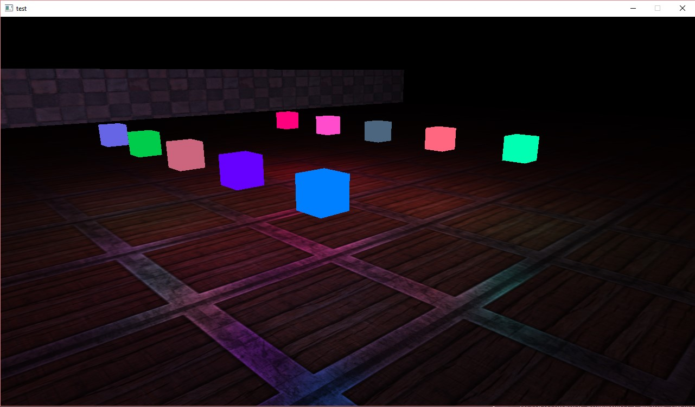
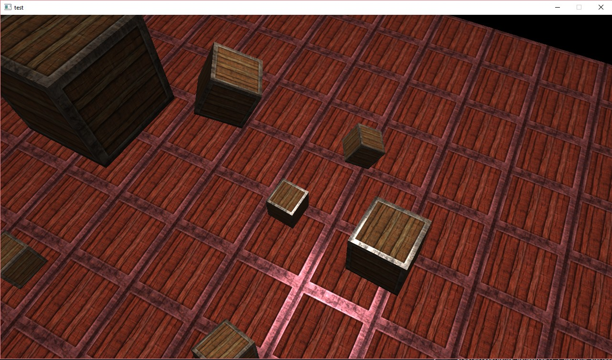
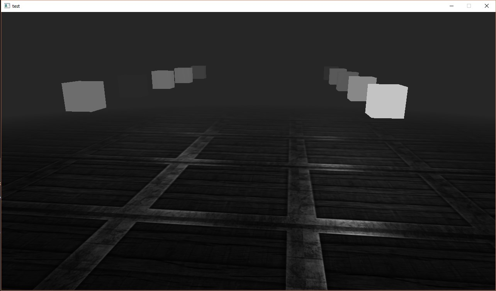

# Frost — Early C++ 3D Engine (2016)

A from-scratch OpenGL rendering engine written in C++, built to learn graphics
and engine architecture.

## Features
- Camera, transform hierarchy, and material systems
- Phong lighting (directional / point / spot) with normal mapping
- Runtime GLSL shader compilation
- Framebuffer-based post-processing
- Built on **GLFW** (window/input), **GLEW** (OpenGL), **SOIL** (textures), and a
  from-scratch math library ([Cinder Math](https://github.com/EsamElKholy/Cinder-Project))

| Textured meshes & materials | Atmospheric single-light scene |
| --- | --- |
|  |  |

> An early graphics + engine-architecture **study from 2016**, written in
> pre-modern (C++98/03-era) idioms. Kept public as a learning artifact — not a
> maintained or production engine.
